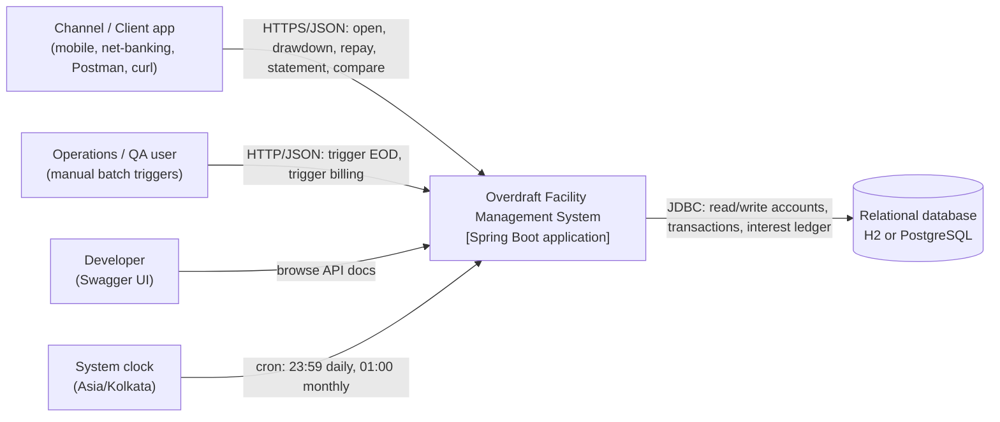
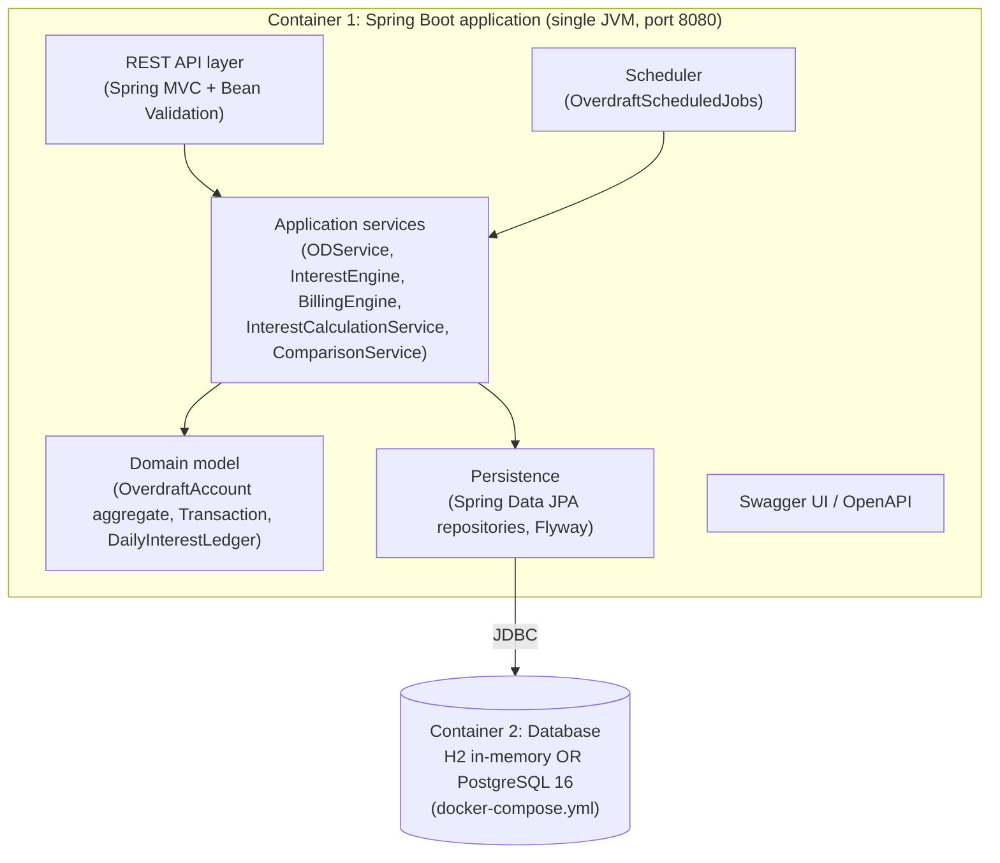
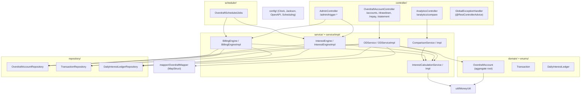
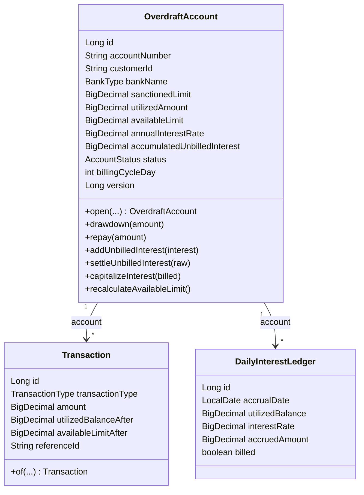
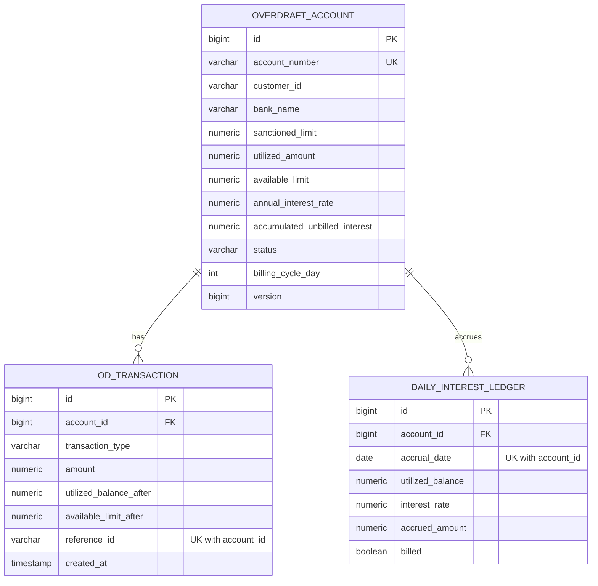
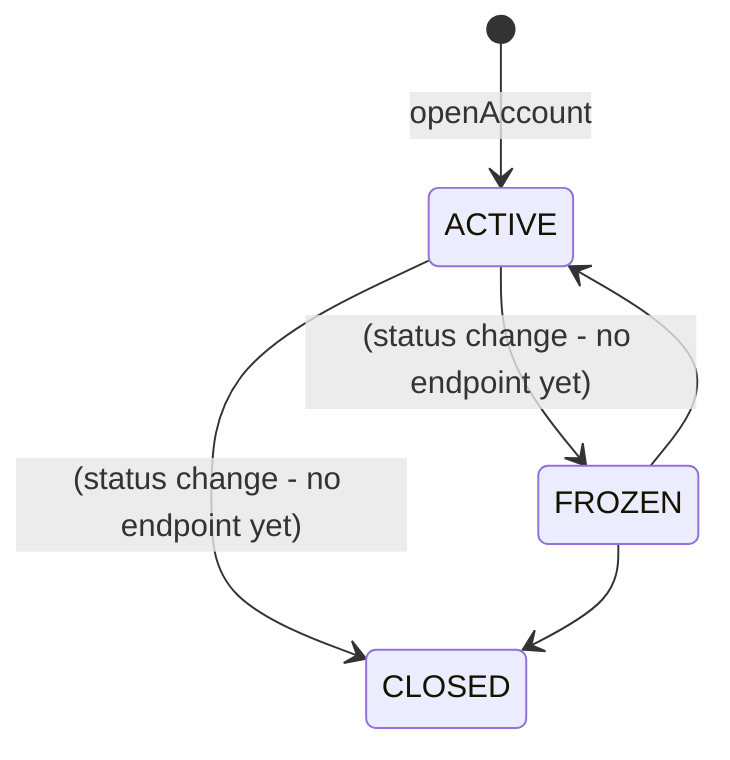
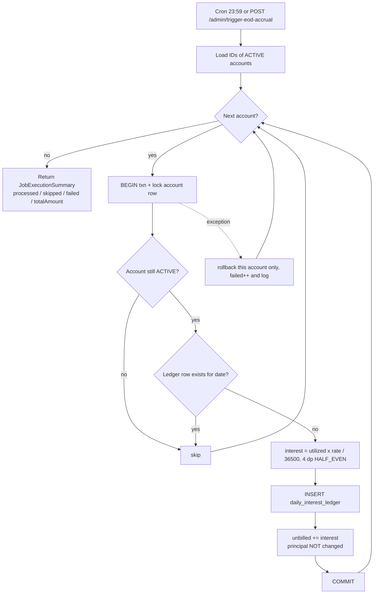
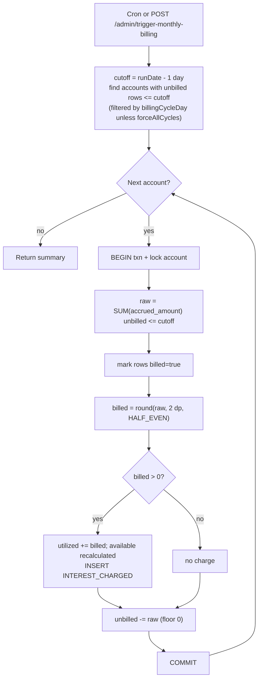
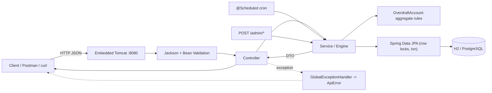

# Enterprise Bank Overdraft (OD) Facility Management System

Spring Boot 3.2 core-banking module for **overdraft / revolving credit-line** management: account opening, drawdown,
flexible repayment, end-of-day (EOD) daily interest accrual, monthly interest billing with capitalization, and an
OD-vs-Personal-Loan analytics calculator.

> ## Scope of this document (read first)
> This repository is a **single deployable Spring Boot application (a modular monolith)** backed by one relational
> database. This README documents **only what exists in the code**, using the C4 model (Context -> Container ->
> Component -> Code).
>
> It deliberately does **not** describe an API gateway, service discovery, Kafka/Debezium, CQRS read stores, Kubernetes,
> Terraform, Route 53/WAF/CloudFront or JWT/OAuth2 - none of these exist in this repo. Section 12 lists them in a
> "not implemented" table so nobody goes looking for them. Where a number is a *target* rather than a measurement,
> it is labelled **target (not benchmarked)**.

---

## Table of contents

1. [Quick facts](#1-quick-facts)
2. [C4 Level 1 - System Context](#2-c4-level-1---system-context)
3. [C4 Level 2 - Containers (HLD)](#3-c4-level-2---containers-hld)
4. [C4 Level 3 - Components (HLD)](#4-c4-level-3---components-hld)
5. [C4 Level 4 - Code (LLD)](#5-c4-level-4---code-lld)
6. [Component deep-dive: the six parameters](#6-component-deep-dive-the-six-parameters)
7. [End-to-end workflows (happy and failure paths)](#7-end-to-end-workflows-happy-and-failure-paths)
8. [Design patterns used - when they run](#8-design-patterns-used---when-they-run)
9. [Interest mathematics](#9-interest-mathematics)
10. [Personal loan vs overdraft](#10-personal-loan-vs-overdraft)
11. [Run locally - step by step](#11-run-locally---step-by-step)
12. [What is NOT in this repo](#12-what-is-not-in-this-repo)
13. [Testing guide](#13-testing-guide)
14. [How to read the code (beginner path)](#14-how-to-read-the-code-beginner-path)
15. [Known limitations and roadmap](#15-known-limitations-and-roadmap)
16. [Repository layout](#16-repository-layout)

---

## 1. Quick facts

| Item | Value |
|---|---|
| Language / runtime | Java 17+ |
| Framework | Spring Boot 3.2.5 (Web, Data JPA, Validation, Scheduling) |
| Database | H2 in PostgreSQL mode (default and tests) or PostgreSQL 16 |
| Migrations | Flyway `V1__init_overdraft_schema.sql`; Hibernate runs in `validate` mode |
| Money | `BigDecimal` only: 4 dp internal, 2 dp billing, `RoundingMode.HALF_EVEN` |
| API docs | springdoc OpenAPI / Swagger UI at `/swagger-ui.html` |
| Tooling | Lombok, MapStruct |
| Deployable units | **1** (one JAR, one DB) |
| REST endpoints | 7 |
| Scheduled jobs | 3 (EOD accrual, monthly billing, cycle-day billing) |
| Tests | 5 classes: 3 unit, 2 Spring Boot integration |

---

## 2. C4 Level 1 - System Context

*Who uses the system and what does it talk to?*



| Actor / system | Interaction |
|---|---|
| Channel / client | Calls the REST API. No authentication layer exists in this repo (see section 15). |
| Operations / QA | Uses `/admin/*` endpoints to run batch jobs on demand for a chosen business date. |
| Developer | Swagger UI / OpenAPI JSON. |
| Scheduler (internal) | Spring `@Scheduled` triggers the same engines the admin endpoints call. |
| Database | Sole persistence; the only external dependency at runtime. |

There are **no outbound calls** to other systems (no payment gateway, no message broker, no core-banking GL).

---

## 3. C4 Level 2 - Containers (HLD)

*What are the separately runnable/deployable pieces?*



| Container | Technology | Responsibility | Runs how |
|---|---|---|---|
| Application | Java 17, Spring Boot 3.2.5 | All business logic, API, batch jobs | `./mvnw spring-boot:run` or `java -jar` |
| Database | H2 (embedded) or PostgreSQL 16 | Durable state, constraints, locks | H2: inside the JVM; PostgreSQL: `docker compose up -d` |

**Startup order inside the one JVM** (this is the "what starts after what" for this project):
1. Datasource connects -> 2. **Flyway** applies `V1__init_overdraft_schema.sql` -> 3. **Hibernate** validates entities
against the schema -> 4. Spring wires services, controllers, scheduler -> 5. Tomcat opens port 8080 ->
6. cron triggers become active.

If step 2 or 3 fails the application does not start, which is intentional (schema drift is caught at boot).

---

## 4. C4 Level 3 - Components (HLD)

*What are the building blocks inside the application container?*



Dependency rules actually followed in the code:

- Controllers depend on **service interfaces** only; they never touch repositories.
- Business invariants live in the **domain aggregate** (`OverdraftAccount.drawdown/repay/capitalizeInterest`).
- Batch engines own their transaction boundaries (`TransactionTemplate`, one transaction per account).
- All scale/rounding decisions go through `MoneyUtil`.
- The current time comes from an injected `Clock`, never `LocalDate.now()` directly in services.

---

## 5. C4 Level 4 - Code (LLD)

### 5.1 Domain class diagram



### 5.2 Database schema (`V1__init_overdraft_schema.sql`)



Database-level guarantees (independent of Java): `utilized_amount >= 0`, `sanctioned_limit > 0`,
`annual_interest_rate` 0-100, `billing_cycle_day` 1-28, status and transaction-type `CHECK` lists, `amount > 0`,
`UNIQUE(account_id, reference_id)` (idempotency), `UNIQUE(account_id, accrual_date)` (one accrual per day).
Index `(billed, accrual_date)` serves the billing query.

### 5.3 Account state machine



| Operation | ACTIVE | FROZEN | CLOSED |
|---|---|---|---|
| Drawdown | allowed | **409** `INVALID_ACCOUNT_STATE` | **409** |
| Repay | allowed | allowed | **409** |
| EOD accrual | accrues | skipped | skipped |
| Billing of existing unbilled interest | yes | yes | yes |

No REST endpoint changes status today; the rules are enforced in the aggregate and covered by `OverdraftAccountTest`.

### 5.4 Sequence: drawdown (the core write path)

```mermaid
sequenceDiagram
    participant C as Client
    participant MVC as Spring MVC + Bean Validation
    participant CT as OverdraftAccountController
    participant SV as ODServiceImpl
    participant RP as Repositories
    participant AG as OverdraftAccount
    participant DB as Database

    C->>MVC: POST /accounts/{no}/drawdown {amount, referenceId}
    MVC->>MVC: validate amount >= 0.01, max 2 decimals
    alt invalid body
        MVC-->>C: 400 VALIDATION_FAILED (violations[])
    end
    MVC->>CT: TransactionRequest
    CT->>SV: drawdown(no, request)
    SV->>RP: findByAccountNumberForUpdate (BEGIN txn)
    RP->>DB: SELECT ... FOR UPDATE
    alt account missing
        SV-->>C: 404 ACCOUNT_NOT_FOUND
    end
    SV->>RP: existsByAccountIdAndReferenceId
    alt reference already used
        SV-->>C: 409 DUPLICATE_TRANSACTION
    end
    SV->>AG: drawdown(amount)
    AG->>AG: status ACTIVE? amount <= available?
    alt rule violated
        AG-->>C: 409 INVALID_ACCOUNT_STATE or 422 INSUFFICIENT_LIMIT (txn rolled back)
    end
    AG->>AG: utilized += amount; available = sanctioned - utilized
    SV->>RP: save Transaction (DRAWDOWN snapshot)
    SV-->>CT: TransactionResponse (COMMIT releases row lock)
    CT-->>C: 200 OK
```

### 5.5 Flow: EOD interest accrual



### 5.6 Flow: monthly billing



### 5.7 API contract summary

| # | Method and path | Success | Main errors |
|---|---|---|---|
| 1 | `POST /api/v1/overdraft/accounts` | 201 `AccountResponse` | 400 |
| 2 | `POST /api/v1/overdraft/accounts/{accountNumber}/drawdown` | 200 `TransactionResponse` | 400, 404, 409, 422 |
| 3 | `POST /api/v1/overdraft/accounts/{accountNumber}/repay` | 200 `TransactionResponse` | 400, 404, 409, 422 |
| 4 | `GET  /api/v1/overdraft/accounts/{accountNumber}/statement?limit=` | 200 `StatementResponse` | 400, 404 |
| 5 | `POST /api/v1/overdraft/admin/trigger-eod-accrual?businessDate=` | 200 `JobExecutionSummary` | 400 |
| 6 | `POST /api/v1/overdraft/admin/trigger-monthly-billing?businessDate=&forceAllCycles=` | 200 `JobExecutionSummary` | 400 |
| 7 | `GET  /api/v1/overdraft/analytics/compare?sanctionedLimit=&utilizedAmount=&interestRate=&holdingDays=` | 200 `ComparisonResponse` | 400 |

Error body (all domain/validation errors): `{timestamp, status, code, message, path, violations[]}`.

| Code | HTTP | Raised when |
|---|---:|---|
| `VALIDATION_FAILED` | 400 | Bean Validation / constraint failure |
| `MALFORMED_REQUEST` | 400 | Unreadable JSON, unknown enum value |
| `INVALID_REQUEST` | 400 | Cross-field rule (compare: utilized > limit) |
| `ACCOUNT_NOT_FOUND` | 404 | Unknown account number |
| `INVALID_ACCOUNT_STATE` | 409 | Operation not allowed in current status |
| `DUPLICATE_TRANSACTION` | 409 | `referenceId` already used on the account |
| `INSUFFICIENT_LIMIT` | 422 | Drawdown > available limit |
| `REPAYMENT_EXCEEDS_OUTSTANDING` | 422 | Repayment > utilized amount |
| `INTERNAL_ERROR` | 500 | Anything unexpected (details hidden from client, logged server-side) |

Spring-raised errors without a custom mapping (missing request parameter, bad date format) return RFC 7807 problem JSON with HTTP 400.

---

## 6. Component deep-dive: the six parameters

For every component: (1) purpose, (2) KPIs, (3) data flow/response time/failure impact, (4) technology, advantages and
limitations, (5) scalability and performance targets, (6) security, reliability and compliance.

> **Reading the numbers.** The code contains no metrics (no Actuator/Micrometer) and no benchmark has been run.
> KPIs are what you *should* track; response-time and throughput figures are **targets (not benchmarked)**. The only
> built-in signal today is `JobExecutionSummary` (returned by admin endpoints and logged by the engines) plus logs.

### 6.1 REST API layer (`controller/` + Bean Validation)

| # | Parameter | Detail |
|---|---|---|
| 1 | **Purpose and responsibilities** | Expose the 7 endpoints; bind and validate JSON/query input (`@Valid`, `@Validated`, `@DecimalMin`, `@Digits`, `@Min/@Max`); delegate to service interfaces; choose HTTP status (201 on open, 200 otherwise); publish OpenAPI annotations. Contains **no business logic and no DB access**. |
| 2 | **KPIs** | Request success rate (non-5xx / total) - target >= 99.9%; p95/p99 latency per endpoint; 4xx ratio by `code` (a spike of `INSUFFICIENT_LIMIT` or `VALIDATION_FAILED` signals client bugs); 5xx count (should be ~0). |
| 3 | **Data flow, response time, failure impact** | *Flow:* HTTP -> DispatcherServlet -> Jackson -> validation -> controller -> service -> DTO -> Jackson. *Time (target, not benchmarked):* p95 < 100 ms for statement/compare, < 200 ms for drawdown/repay (one locked row + one insert). *Failure impact:* validation failure is rejected before any DB work (no side effects). If the controller layer is down, nothing is reachable but no data is lost; batch jobs still run (they bypass HTTP). |
| 4 | **Technology, advantages, limitations** | Spring MVC + Jakarta Validation + springdoc. *Advantages:* declarative validation, consistent errors via one advice, self-documenting Swagger. *Limitations:* no authentication/authorization, no rate limiting, no API versioning beyond the `/v1` path, `/admin/*` is publicly reachable, statement is not paginated by cursor (only `limit`). |
| 5 | **Scalability and performance targets** | Stateless, so horizontally scalable behind any load balancer. Target (not benchmarked): ~200 write req/s per instance bounded by DB row locks and the Hikari pool (default 10 connections). Per-account operations serialize on the account row, so hot accounts are the bottleneck, not the web tier. |
| 6 | **Security, reliability, compliance** | Input is strictly validated (amount min 0.01, max 2 decimals, limits, enum binding) which blocks malformed money values. Error responses never expose stack traces (`INTERNAL_ERROR` is generic). **Gaps:** no authN/Z, no TLS termination in-app, no audit of *who* called. Required before real use: Spring Security (JWT/OIDC), role-protect `/admin/**`, TLS at the edge. |

### 6.2 `ODService` / `ODServiceImpl` (account lifecycle and transactions)

| # | Parameter | Detail |
|---|---|---|
| 1 | **Purpose and responsibilities** | `openAccount` (unique account number, zero utilization), `drawdown`, `repay` (lock row, idempotency check, delegate rule enforcement to the aggregate, write the transaction snapshot), `getStatement` (read-only assembly of account + utilization breakdown + newest transactions + newest interest rows). Owns the transaction boundary of each call (`@Transactional`). |
| 2 | **KPIs** | Drawdown/repay success rate; share of rejected requests by reason; duplicate-reference (409) rate (retry behaviour of clients); lock wait time on `overdraft_account`; statement latency vs `limit`. |
| 3 | **Data flow, response time, failure impact** | *Flow:* `SELECT ... FOR UPDATE` on the account -> duplicate-reference check -> aggregate mutation -> `INSERT od_transaction` -> commit. *Time (target):* < 50 ms service time uncontended. *Failure impact:* any exception rolls back the whole call, so state and transaction row can never diverge. DB unavailable -> 500; no partial writes. Concurrent calls on the same account queue on the row lock; different accounts do not block each other. |
| 4 | **Technology, advantages, limitations** | Spring `@Transactional`, JPA pessimistic lock, MapStruct. *Advantages:* correctness under concurrency, idempotent retries (`referenceId`), snapshot of balances in every transaction row (cheap audit). *Limitations:* `referenceId` is optional (clients that omit it get no idempotency); account number generated with `ThreadLocalRandom` + existence check (a rare simultaneous collision surfaces as 500 via the unique constraint, and numbers are not cryptographically random); `getStatement` reads without a lock so it can show a point-in-time view mid-batch. |
| 5 | **Scalability and performance targets** | Throughput per account = 1 / (lock hold time), roughly hundreds of ops/s on one account in theory; across accounts scales with the connection pool and DB. Scale-out: more app instances (locks live in the DB, so this is safe). Reads can move to a replica later. Target (not benchmarked): 95% of drawdowns < 200 ms at 100 concurrent users on a modest PostgreSQL. |
| 6 | **Security, reliability, compliance** | ACID per operation; `@Version` optimistic guard as a second line of defence; DB CHECK constraints as a third. Append-only transaction rows support reconciliation (balance after each event is stored). Money never uses floating point. **Gaps:** no actor identity on transactions, no maker-checker, no limit on drawdown velocity. |

### 6.3 `InterestEngine` / `InterestEngineImpl` (EOD accrual)

| # | Parameter | Detail |
|---|---|---|
| 1 | **Purpose and responsibilities** | For a business date, accrue one day of interest on the closing utilized balance of every ACTIVE account: insert a `daily_interest_ledger` row and add the amount to `accumulated_unbilled_interest`. **Never changes principal** (no intra-month compounding). Returns a `JobExecutionSummary`. |
| 2 | **KPIs** | `accountsFailed` (target 0); job duration vs the nightly window; coverage = accounts with a ledger row for the date / ACTIVE accounts (target 100%); total accrued vs expected (reconciliation: sum of ledger = sum of unbilled buckets). |
| 3 | **Data flow, response time, failure impact** | *Flow:* load ACTIVE ids -> per account: txn { lock, skip if already accrued, compute, insert ledger, update bucket }. *Time (estimate, not measured):* a few ms per account, sequential, so ~1-2 minutes per 100k accounts. *Failure impact:* one account failing is logged and counted, others continue. **A missed day is not auto-recovered**: the job only runs for "today"; re-running a past date through the admin endpoint uses the *current* balance, which may differ from that day's closing balance. If the whole job is skipped for a day, customers are under-charged for that day. |
| 4 | **Technology, advantages, limitations** | Spring `TransactionTemplate`, JPA pessimistic lock. *Advantages:* idempotent (unique `(account_id, accrual_date)` + pre-check), failure-isolated per account, replayable by date, safe if two nodes fire simultaneously. *Limitations:* sequential loop; no back-fill from transaction history; no pagination of the id list (all IDs in memory); FROZEN accounts do not accrue (per specification). |
| 5 | **Scalability and performance targets** | Cost is linear in the number of active accounts. Target (not benchmarked): complete well inside a 30-minute window for 1M accounts after partitioning. Scale options: split ids into ranges and process in parallel workers, or migrate to Spring Batch with chunking and restartability. |
| 6 | **Security, reliability, compliance** | Reliability through idempotency and per-account transactions; correctness through a single-division formula with one rounding step. Ledger rows are the **audit evidence** for every interest rupee later billed (utilized balance and rate are stored on each row). **Gaps:** the admin endpoint that triggers it is unauthenticated and accepts any date (including future ones). |

### 6.4 `BillingEngine` / `BillingEngineImpl` (monthly billing and capitalization)

| # | Parameter | Detail |
|---|---|---|
| 1 | **Purpose and responsibilities** | Sum all unbilled ledger rows up to `runDate - 1`, round to 2 dp (HALF_EVEN), mark rows billed, add the amount to the utilized balance (capitalization), write an `INTEREST_CHARGED` transaction, reduce the unbilled bucket. Honours `billingCycleDay` unless `forceAllCycles=true`. |
| 2 | **KPIs** | `accountsFailed` (target 0); billed total vs sum of ledger rows (difference only from sub-paisa rounding); number of unbilled rows older than one cycle (target 0); count of accounts pushed over limit by capitalization. |
| 3 | **Data flow, response time, failure impact** | *Flow:* find account ids with unbilled rows -> per account txn { lock, sum, mark billed, capitalize, insert transaction }. *Time (estimate):* a few ms per account. *Failure impact:* a failing account rolls back entirely (rows stay unbilled and are picked up by the next run). Re-running is a no-op because billed rows are excluded. If billing is late, interest simply waits; nothing is lost. |
| 4 | **Technology, advantages, limitations** | JPQL aggregate (`SUM`) and bulk update (`markBilled`), `TransactionTemplate`. *Advantages:* idempotent, atomic per account, catches up automatically (bills everything <= cutoff). *Limitations:* the sub-paisa residual (< 0.005) is dropped when the bucket is reset; capitalized interest can make `available` negative; cycle days 29-31 are not allowed (validation 1-28) so no month-end special-casing is needed. |
| 5 | **Scalability and performance targets** | Linear in accounts with unbilled interest; same parallelization options as the accrual engine. Target (not benchmarked): 1M accounts < 30 minutes after partitioning. |
| 6 | **Security, reliability, compliance** | Each charge has a transaction row that records the post-charge balances and a description of the accrual cut-off; together with the ledger this gives a complete interest audit trail. HALF_EVEN rounding avoids systematic bias. **Gaps:** no GL posting or event emission; no customer notification; admin trigger unauthenticated. |

### 6.5 Calculation services (`InterestCalculationService`, `ComparisonService`)

| # | Parameter | Detail |
|---|---|---|
| 1 | **Purpose and responsibilities** | `InterestCalculationService`: the single source of the interest formula (`utilized x rate / (100 x daysInYear)`, 4 dp), 365/366 day-basis switch, 2 dp billing rounding. `ComparisonService`: EMI-based personal-loan cost vs OD cost for the analytics endpoint. Pure functions - no I/O. |
| 2 | **KPIs** | Exactness: unit tests assert results to the paisa/4 dp (any regression fails the build); analytics usage count; zero divergence between analytics OD interest and ledger-based interest on a constant balance. |
| 3 | **Data flow, response time, failure impact** | *Flow:* arguments in -> BigDecimal arithmetic -> value out. *Time:* microseconds (compare: < 5 ms). *Failure impact:* a wrong formula here would mis-charge every account, which is why it is isolated, immutable and heavily unit-tested. Invalid input throws (`InvalidRequestException` -> 400). |
| 4 | **Technology, advantages, limitations** | `java.math.BigDecimal`, `MathContext.DECIMAL128` for EMI powers. *Advantages:* deterministic, no float error, easy to test. *Limitations:* analytics compare uses the **same nominal rate** for both products, simple (non-compounding) OD interest over the period and `ceil(days/30)` months for the loan tenure, so it is an illustration, not a quotation. |
| 5 | **Scalability and performance targets** | CPU-trivial, stateless, thread-safe; no scaling concern. |
| 6 | **Security, reliability, compliance** | Banker's rounding (`HALF_EVEN`) per the specification; null and sign guards; leap-year handling is configuration-driven (`overdraft.interest.leap-year-aware`) so the day-count convention is an explicit, auditable choice. |

### 6.6 Scheduler (`OverdraftScheduledJobs`)

| # | Parameter | Detail |
|---|---|---|
| 1 | **Purpose and responsibilities** | Fire the engines on a cron: `0 59 23 * * *` EOD accrual; `0 0 1 1 * *` monthly billing (cycle day 1); `0 0 1 2-28 * *` billing for accounts whose cycle day equals today's day-of-month. Zone from `overdraft.timezone`. Can be switched off with `overdraft.scheduler.enabled=false`. |
| 2 | **KPIs** | Job start-on-time rate; job success (`accountsFailed == 0`); duration; "days without an accrual run" (target 0). |
| 3 | **Data flow, response time, failure impact** | *Flow:* cron -> `LocalDate.now(clock)` -> engine -> summary logged. *Failure impact:* if the JVM is down at 23:59 the day is **missed** (Spring cron has no catch-up); an operator must run the admin endpoint. Exceptions inside a job are contained per account by the engines. |
| 4 | **Technology, advantages, limitations** | Spring `@Scheduled`. *Advantages:* zero infrastructure, easy to disable and test (engines take explicit dates). *Limitations:* no distributed lock (multi-instance deployments run the job on every node - safe because of idempotency, but wasteful), no misfire handling or history table. |
| 5 | **Scalability and performance targets** | Run on a single designated node or add ShedLock/Quartz; move to Spring Batch for partitioned, restartable runs. |
| 6 | **Security, reliability, compliance** | Runs in-process, no network surface. Reliability depends on the process being up at trigger time (see failure impact). The business date comes from the injected `Clock` in the bank's time zone, avoiding UTC/IST date drift. |

### 6.7 Domain model (`domain/`, `enums/`)

| # | Parameter | Detail |
|---|---|---|
| 1 | **Purpose and responsibilities** | `OverdraftAccount` is the aggregate root enforcing the invariants: `available = sanctioned - utilized`, drawdown only when ACTIVE and within limit, repayment never above utilized and not on CLOSED, accrual never touches principal. `Transaction` = immutable-style snapshot of each balance-changing event. `DailyInterestLedger` = one row per account per day. |
| 2 | **KPIs** | Invariant violations (must be 0 - verify with a reconciliation query: `available = sanctioned - utilized`); mismatch between `utilized_balance_after` of the last transaction and the account; `SUM(ledger.accrued where billed=false) = accumulated_unbilled_interest`. |
| 3 | **Data flow, response time, failure impact** | In-memory logic executed inside the service's transaction; microsecond cost. A violated rule throws a typed exception that rolls back the transaction, so invalid state is never persisted. |
| 4 | **Technology, advantages, limitations** | JPA/Hibernate, Lombok, Java records for DTOs. *Advantages:* rules are in one place and unit-testable without Spring (`OverdraftAccountTest`). *Limitations:* entities use Lombok setters (the status can be set from anywhere in the app); `@PreUpdate` stamps `updatedAt` with the system default zone rather than the injected `Clock`; no domain events. |
| 5 | **Scalability and performance targets** | Entities are small; the hot row is the account (one writer at a time). Partitioning by account (sharding) is the long-term scale path. |
| 6 | **Security, reliability, compliance** | Precision-safe money (NUMERIC(19,4)); balances snapshotted on each transaction for reconciliation; DB CHECK constraints mirror the rules (defence in depth); `@Version` for optimistic locking. |

### 6.8 Persistence (`repository/`, Flyway, database)

| # | Parameter | Detail |
|---|---|---|
| 1 | **Purpose and responsibilities** | Durable storage and concurrency control: Spring Data repositories (including `PESSIMISTIC_WRITE` finders, a `SUM` aggregate and a bulk `UPDATE`), Flyway-owned schema, constraints and indexes. |
| 2 | **KPIs** | Query p95 latency; lock wait/timeout count; connection-pool saturation; table growth (ledger grows by `accounts x days`); failed migrations (0). |
| 3 | **Data flow, response time, failure impact** | JPA -> Hikari -> JDBC -> DB. Account lookups by unique `account_number` (indexed). *Failure impact:* **the database is the single point of failure** - if it is down every endpoint returns 500 and batch jobs log failures; nothing is queued or retried. Schema mismatch blocks startup. |
| 4 | **Technology, advantages, limitations** | PostgreSQL 16 / H2, Flyway, Hibernate `validate`. *Advantages:* same SQL on H2 (tests/dev) and PostgreSQL (prod); constraints enforce invariants even for manual SQL. *Limitations:* H2 is in-memory by default (data is lost on restart); a single database instance; ledger and transaction tables have no archival/partitioning strategy; `ddl-auto: validate` means every schema change needs a new Flyway version. |
| 5 | **Scalability and performance targets** | Start with vertical scaling + connection-pool tuning; add a read replica for statements; partition `daily_interest_ledger` by month when it reaches tens of millions of rows. Target (not benchmarked): ledger lookups by `(account_id, accrual_date)` < 5 ms. |
| 6 | **Security, reliability, compliance** | Use PostgreSQL with TLS, least-privilege DB user, encrypted volumes and automated backups/PITR in any real environment (the `docker-compose.yml` credentials are **development defaults only**). Append-only style tables plus constraints support audit; retention policy must be defined per banking regulation. |

### 6.9 Cross-cutting (exception handling, config, mapper, utilities)

| # | Parameter | Detail |
|---|---|---|
| 1 | **Purpose and responsibilities** | `GlobalExceptionHandler`: map every failure to a stable `{code, message, path, violations}` body and HTTP status. `config/`: injected `Clock`, Jackson (plain decimals, ISO dates), OpenAPI metadata, scheduling switch. `mapper/`: MapStruct entity -> DTO. `util/MoneyUtil`: scales and rounding in one place. |
| 2 | **KPIs** | Share of responses using the standard error body (target 100% for app-raised errors); number of `INTERNAL_ERROR`s; no BigDecimal formatted in scientific notation in any response. |
| 3 | **Data flow, response time, failure impact** | Sits on the exception path and serialization path; negligible latency. If it were wrong, clients would get inconsistent errors but data would still be safe. Unexpected exceptions are logged with stack trace and returned as a generic 500. |
| 4 | **Technology, advantages, limitations** | `@RestControllerAdvice` extending `ResponseEntityExceptionHandler`, MapStruct, springdoc. *Advantages:* one place for error semantics; compile-time mappers. *Limitations:* Spring-raised errors without an override (e.g. missing request parameter) use RFC 7807 problem JSON rather than `ApiError`; no correlation/trace id in errors. |
| 5 | **Scalability and performance targets** | Stateless and effectively free. |
| 6 | **Security, reliability, compliance** | Error responses never leak internals. `Clock` bean pins the bank's time zone (Asia/Kolkata by default) so business dates are deterministic. **Gap:** no request logging/redaction policy or correlation IDs. |

---

## 7. End-to-end workflows (happy and failure paths)

### 7.1 Overall system flow



### 7.2 Business lifecycle (what really happens over a month)

| Step | Trigger | What the system does | Persistent result |
|---|---|---|---|
| 1 | `POST /accounts` | Creates ACTIVE account: utilized 0, available = limit | `overdraft_account` row |
| 2 | `POST .../drawdown` | Lock, validate, `utilized += amount` | account updated + `DRAWDOWN` row |
| 3 | 23:59 each day | Accrue `utilized x rate / 36500` on the closing balance | `daily_interest_ledger` row + unbilled bucket increases; principal unchanged |
| 4 | `POST .../repay` (any time) | `utilized -= amount`, no fee | account updated + `REPAYMENT` row; next EOD uses the lower balance |
| 5 | 1st (or cycle day) 01:00 | Sum unbilled rows, round to 2 dp, capitalize | `INTEREST_CHARGED` row, utilized increases, bucket reset, rows `billed=true` |
| 6 | `GET .../statement` | Read-only assembly | nothing written |

### 7.3 Failure paths (what actually happens)

There is **no distributed workflow and no saga** in this system: every business operation is one local ACID transaction,
so a failure means "nothing happened" rather than "compensate".

| # | Failure scenario | How to trigger | Behaviour | Result |
|---|---|---|---|---|
| F1 | Drawdown above available limit | `amount` = available + 0.01 | Aggregate throws `InsufficientLimitException`; transaction rolls back | **422** `INSUFFICIENT_LIMIT`; no row written; balances unchanged |
| F2 | Repay more than owed | repay `0.01` on a zero-balance account | `RepaymentExceedsOutstandingException` | **422** `REPAYMENT_EXCEEDS_OUTSTANDING` |
| F3 | Retry of the same request | resend same `referenceId` | Duplicate check before any mutation | **409** `DUPLICATE_TRANSACTION`; balance moved only once |
| F4 | Unknown account | any call with a bad number | Lookup fails | **404** `ACCOUNT_NOT_FOUND` |
| F5 | Wrong state | (unit-tested) FROZEN drawdown / CLOSED repay | `InvalidAccountStateException` | **409** `INVALID_ACCOUNT_STATE` |
| F6 | Bad input | amount `0` or `10.123`, blank customer, rate 150, malformed JSON, unknown bank | Rejected before the service is called | **400** `VALIDATION_FAILED` / `MALFORMED_REQUEST` with `violations[]` |
| F7 | EOD job run twice for a date | call the trigger twice | Second run finds the ledger row and skips | `accountsProcessed = 0`, no double interest |
| F8 | Billing job run twice | call the trigger twice | Rows already `billed=true` | No second charge |
| F9 | One account fails mid-batch | e.g. DB error on one row | That account's transaction rolls back; loop continues | `accountsFailed = 1`, logged; others complete; the failed account is retried on the next run |
| F10 | Two simultaneous drawdowns on one account | concurrent requests | Second waits on `FOR UPDATE`, then re-evaluates against the new balance | Second may get 422; total can never exceed the limit |
| F11 | Database down | stop PostgreSQL | Connection errors | **500** `INTERNAL_ERROR`; no partial state; batch logs failures |
| F12 | JVM down at 23:59 | stop the app overnight | Cron does not fire | Day missed - run `POST /admin/trigger-eod-accrual?businessDate=...` manually (see limitation in 6.3) |

---

## 8. Design patterns used - when they run

| Pattern | Where in the code | When it is invoked | Workflow |
|---|---|---|---|
| **Layered architecture** | `controller -> service -> repository/domain` | Every request | Controller validates and delegates; service owns the transaction; repository does I/O |
| **Rich domain model / Aggregate root** | `OverdraftAccount.drawdown/repay/capitalizeInterest` | Every balance change | Service calls the aggregate; aggregate enforces rules and recomputes `available` |
| **Factory method** | `OverdraftAccount.open(...)`, `Transaction.of(...)` | Account opening; every transaction record | Guarantees valid initial state and a post-change balance snapshot |
| **Repository** | Spring Data interfaces | All persistence | Derived queries + `@Query` for locks, SUM and bulk update |
| **DTO + Mapper** | Java records, MapStruct `OverdraftMapper` | Every response | Entities never leave the service layer; money fields are rounded in the record constructors |
| **Pessimistic locking** | `findByAccountNumberForUpdate`, `findByIdForUpdate` | Drawdown, repay, EOD, billing | `SELECT ... FOR UPDATE` serializes writers per account |
| **Optimistic locking** | `@Version` on `OverdraftAccount` | Any update | Second line of defence if a write bypasses the lock |
| **Idempotency** | `referenceId` + `UNIQUE(account_id, reference_id)`; `UNIQUE(account_id, accrual_date)`; `billed` flag | Client retries; job re-runs | Duplicate detected -> 409 / skip, never double-applied |
| **Per-item transaction (batch isolation)** | `TransactionTemplate` in both engines | EOD and billing loops | Each account commits or rolls back alone; failures are counted, not fatal |
| **Scheduled job** | `OverdraftScheduledJobs` | 23:59 daily; 01:00 on day 1; 01:00 on days 2-28 | Cron -> `LocalDate.now(clock)` -> engine |
| **Append-only ledger / audit trail** | `daily_interest_ledger`, `od_transaction` | Each accrual / balance change | Rows are inserted, never edited (except the `billed` flag) |
| **Global exception handling (Controller Advice)** | `GlobalExceptionHandler` + `OverdraftException` hierarchy | Any exception | Domain exception carries HTTP status and code; advice builds `ApiError` |
| **Dependency inversion / interface-impl split** | `ODService` / `ODServiceImpl`, etc. | Wiring time | Controllers and scheduler depend on interfaces; enables unit tests with plain `new` |
| **Clock injection** | `ClockConfig` bean | Everywhere "today" is needed | Business date from the bank's zone; tests/admin pass explicit dates |
| **Schema-as-code + validate** | Flyway + `ddl-auto: validate` | Startup | Boot fails fast on drift |

### Patterns you may expect from "microservice" projects that are **not** in this repo

| Pattern | Status | Note |
|---|---|---|
| API Gateway + rate limiting | Not implemented | Single service on :8080; add at an ingress/gateway when deploying |
| JWT / OAuth2 / OIDC | Not implemented | No Spring Security dependency |
| RBAC / ABAC | Not implemented | `/admin/*` would be the first thing to protect |
| Service discovery (Eureka) / client-side LB | Not implemented | One deployable, nothing to discover |
| Saga, Transactional Outbox, Debezium CDC, Kafka | Not implemented | Single database transaction per operation; no cross-service workflow, no events published |
| CQRS | Not implemented | Statement reads the same tables as writes |
| Circuit breaker (Resilience4j) | Not implemented | No outbound calls to protect |

The system is a good base to add these later (e.g. publish `DRAWDOWN`/`INTEREST_CHARGED` via an outbox once a second
consumer exists), but they would be new work, not documentation of existing behaviour.

---

## 9. Interest mathematics

```
Daily Interest = Utilized Amount x Annual Rate (%) / (100 x 365)
```

- Computed as **one** `BigDecimal` division (`utilized x rate / 36500`), rounded once to 4 dp, `HALF_EVEN`.
- Only the **closing utilized balance** accrues; unused limit costs 0.
- Monthly bill: `billed = round2(sum of daily 4-dp amounts)`; the sub-paisa residual (< 0.005) is dropped when the bucket resets.

**Leap years**

| Mode | Property | Denominator |
|---|---|---|
| Actual/365 Fixed (default) | `overdraft.interest.leap-year-aware=false` | always 365 |
| Actual/Actual | `overdraft.interest.leap-year-aware=true` | 366 in leap years |

Example, 3,00,000 @ 12% on 29-Feb-2024: fixed-365 -> **98.6301**; leap-aware -> **98.3607**.

**Walk-through: 15,00,000 limit, 12% p.a.**

| Day | Event | Closing utilized | Idle limit | Daily interest | Cumulative |
|---:|---|---:|---:|---:|---:|
| 1 | Draw 3,00,000 | 3,00,000 | 12,00,000 | 98.6301 | 98.6301 |
| 2 | - | 3,00,000 | 12,00,000 | 98.6301 | 197.2602 |
| 3 | Repay 1,00,000 | 2,00,000 | 13,00,000 | 65.7534 | 263.0136 |
| 4 | - | 2,00,000 | 13,00,000 | 65.7534 | 328.7670 |
| 5 | Re-draw 50,000 | 2,50,000 | 12,50,000 | 82.1918 | 410.9588 |
| 6 | - | 2,50,000 | 12,50,000 | 82.1918 | 493.1506 |
| 7 | Repay 2,50,000 | 0 | 15,00,000 | 0.0000 | 493.1506 |

Days 1-3 are the integration-test scenario: 263.0136 accrued -> **263.01** billed -> utilized 200,263.01.

---

## 10. Personal loan vs overdraft

| Feature | Personal loan | Overdraft (this system) |
|---|---|---|
| Disbursal | Lump sum on day 1 | Draw any amount up to the limit, when needed |
| Repayment | Fixed EMIs | Flexible; interest billed monthly, principal repaid any time |
| Interest basis | Reducing balance on the whole loan | Daily, only on utilized amount |
| Idle funds | Paid for even if unused | Unused limit costs 0 |
| Prepayment fee | Typically 2-5% | Zero |
| Reusability | One-shot | Revolving |
| Best for | Known one-time expense | Variable working-capital needs |

`GET /analytics/compare` models: loan principal = `sanctionedLimit`, tenure = `ceil(holdingDays/30)` months, same nominal
rate, `EMI = P r (1+r)^n / ((1+r)^n - 1)` with `r = rate/1200` (EMI rounded to 2 dp); OD interest =
`utilized x rate x holdingDays / 36500`; `netSavings = loanInterest - odInterest` (negative means the loan is cheaper).
Example (15L limit, 3L used, 12%, 360 days): EMI 133,273.18, loan interest 99,278.16, OD interest 35,506.85, savings 63,771.31.

---

## 11. Run locally - step by step

There is **one application**, so there is no multi-service start order. The only ordering is *database first (if you
choose PostgreSQL), then the app*. Inside the app the startup order is fixed (see section 3).

### Prerequisites

- JDK 17 or newer (`java -version`)
- Maven 3.9+ **or** just use `./mvnw` (uses your Maven if present, otherwise downloads Maven 3.9.6 into `.mvn/`)
- Docker (only for the PostgreSQL option)

### Option A - H2 (zero setup, recommended first run)

| Step | Command | What to expect |
|---:|---|---|
| 1 | `git clone https://github.com/coder-stat920715/overdraft-facility-system.git && cd overdraft-facility-system` | Project downloaded |
| 2 | `./mvnw clean test` | Unit + integration tests pass (BUILD SUCCESS). Uses the `test` profile. |
| 3 | `./mvnw spring-boot:run` | Log shows Flyway migrating to `v1`, then `Started OverdraftApplication`, port 8080, profile `h2` |
| 4 | Open <http://localhost:8080/swagger-ui.html> | 3 controller groups, 7 endpoints |
| 5 | Run the walkthrough in section 13.3 or import the Postman collection | Responses match the expected values |

Optional: disable cron jobs while demoing so they do not add interest rows at 23:59:
`./mvnw spring-boot:run -Dspring-boot.run.arguments=--overdraft.scheduler.enabled=false`

### Option B - PostgreSQL

| Step | Command | What to expect |
|---:|---|---|
| 1 | `docker compose up -d` | Container `od-postgres` on 5432 (db `overdraft_db`, user `od_user`, password `od_password`) |
| 2 | `docker compose ps` | State `running` (wait a few seconds for readiness) |
| 3 | `./mvnw spring-boot:run -Dspring-boot.run.profiles=postgres` | Flyway creates the 3 tables; application starts |
| 4 | `docker exec -it od-postgres psql -U od_user -d overdraft_db -c '\dt'` | `overdraft_account`, `od_transaction`, `daily_interest_ledger`, `flyway_schema_history` |
| 5 | Open Swagger UI and test as in Option A | Data now survives restarts |

### Option C - run the JAR

```bash
./mvnw clean package
java -jar target/overdraft-facility-system-1.0.0.jar                                  # H2
SPRING_PROFILES_ACTIVE=postgres java -jar target/overdraft-facility-system-1.0.0.jar  # PostgreSQL
```

Stop everything: `Ctrl+C` for the app; `docker compose down` (add `-v` to also delete the database volume).

### Configuration reference

| Property / env var | Default | Meaning |
|---|---|---|
| `spring.profiles.default` | `h2` | Profile when none is set |
| `DB_HOST`, `DB_PORT`, `DB_NAME`, `DB_USER`, `DB_PASSWORD` | localhost, 5432, overdraft_db, od_user, od_password | PostgreSQL profile connection |
| `overdraft.timezone` | `Asia/Kolkata` | Business-date zone and cron zone |
| `overdraft.scheduler.enabled` | `true` | Turn cron jobs on/off |
| `overdraft.interest.leap-year-aware` | `false` | 365-fixed vs 365/366 |
| `server.port` | `8080` | HTTP port |

### Troubleshooting

| Symptom | Cause / fix |
|---|---|
| `Connection refused` on startup (postgres profile) | Database not ready: `docker compose ps`, retry |
| `Schema-validation: wrong column type` | Entity changed without a new Flyway migration |
| Port 8080 busy | `--server.port=8081` |
| Mvnw cannot download Maven | Install Maven or set a proxy |
| Statement shows extra ledger rows | The cron job ran as well; restart with the scheduler disabled |

---

## 12. What is NOT in this repo

To avoid confusion for anyone comparing this project with a microservice reference architecture, the following are
**absent**:

| Topic | Status in this repo | What exists instead |
|---|---|---|
| Route 53 / DNS | None | App is a plain HTTP service on port 8080; DNS is an environment concern |
| CloudFront / CDN | None | API responses are dynamic and not cacheable at an edge in this design |
| AWS WAF / Shield | None | No edge protection; put the service behind a WAF/ALB when deployed |
| Load balancer, mTLS | None | Single instance; TLS not configured |
| Terraform / Ansible | None | No infrastructure-as-code files |
| Kubernetes manifests / Helm | None | Run via `java -jar` or Docker Compose for the database |
| API gateway, Eureka, Resilience4j | None | Not needed for a single service |
| Kafka, Debezium, outbox, saga, CQRS | None | One DB transaction per operation |
| Spring Security, JWT, RBAC/ABAC | None | See limitations below |
| Dockerfile for the app | None | Only the PostgreSQL service is containerized (`docker-compose.yml`) |
| CI/CD pipeline | None | No workflow files |

**The infrastructure-related files that do exist and how they work**

| File | Role |
|---|---|
| `docker-compose.yml` | Defines one service, `postgres:16-alpine`, with db/user/password env vars, port 5432 and a named volume `od-pgdata` so data persists across restarts. Start with `docker compose up -d`. |
| `pom.xml` | Dependencies and build: Spring Boot parent 3.2.5, annotation processors (Lombok, lombok-mapstruct-binding, MapStruct) in the compiler plugin, Boot plugin excluding Lombok from the fat JAR. |
| `mvnw` | Launcher: uses the system `mvn` if found, otherwise downloads Maven 3.9.6 into `.mvn/`. |
| `src/main/resources/application.yml` | Three YAML documents: base settings, `h2` profile, `postgres` profile (selected with `spring.config.activate.on-profile`). |
| `src/test/resources/application-test.yml` | Test profile: H2, scheduler disabled. |
| `src/main/resources/db/migration/V1__init_overdraft_schema.sql` | The whole schema, applied by Flyway at startup. |

---

## 13. Testing guide

### 13.1 Test inventory

| Test class | Type | What it proves |
|---|---|---|
| `service/InterestCalculationServiceTest` | Unit (JUnit 5 + AssertJ) | Daily interest exact to 4 dp for several balances; 3-day total 263.0136 -> 263.01; fixed-365 vs leap-aware (98.6301 vs 98.3607); banker's rounding (2.5050 -> 2.50, 2.5150 -> 2.52) |
| `service/ComparisonServiceTest` | Unit | EMI range, OD interest 35,506.85, savings identity, zero-utilization case, utilized > limit rejected |
| `domain/OverdraftAccountTest` | Unit | Opening state; invariant `available = sanctioned - utilized`; limit boundary; over-repayment; FROZEN/CLOSED rules; accrual does not change principal but capitalization does |
| `integration/OverdraftAccrualScenarioTest` | `@SpringBootTest` (H2) | Full 3-day scenario (draw 300k, repay 100k), idempotent EOD, billing to 200,263.01, idempotent billing, cycle-day behaviour |
| `integration/OverdraftControllerTest` | `@SpringBootTest` + MockMvc | REST lifecycle, 422/409/404/400 mappings, validation violations, analytics endpoint and its validation |

Run: `./mvnw clean test` (single class: `./mvnw -Dtest=InterestCalculationServiceTest test`).
Integration tests clear the three tables before each test and use explicit business dates, so they are repeatable.

### 13.2 Postman

`postman/Overdraft-Facility.postman_collection.json` and `postman/Overdraft-Local.postman_environment.json`:
52 requests in 12 folders with assertions on every step. Full instructions and the expected value of every step are in
[`docs/POSTMAN-TESTING-GUIDE.md`](docs/POSTMAN-TESTING-GUIDE.md). Run it in order with the Collection Runner, or:

```bash
newman run postman/Overdraft-Facility.postman_collection.json -e postman/Overdraft-Local.postman_environment.json
```

### 13.3 Manual walkthrough with curl (happy path)

Start the app (Option A). Use a fresh run so numbers match.

```bash
BASE=http://localhost:8080/api/v1/overdraft

# 1) Open account -> 201, utilized 0.00, available 1500000.00
curl -s -X POST $BASE/accounts -H 'Content-Type: application/json' -d '{
  "customerId":"CUST-1001","bankName":"HDFC","sanctionedLimit":1500000.00,
  "annualInterestRate":12.00,"billingCycleDay":1}'
ACC=<paste accountNumber from the response>

# 2) Day 1: draw 300,000 -> utilized 300000.00, available 1200000.00
curl -s -X POST $BASE/accounts/$ACC/drawdown -H 'Content-Type: application/json' \
  -d '{"amount":300000.00,"referenceId":"DD-1"}'
curl -s -X POST "$BASE/admin/trigger-eod-accrual?businessDate=2026-03-29"     # accrues 98.6301

# 3) Day 2: no change
curl -s -X POST "$BASE/admin/trigger-eod-accrual?businessDate=2026-03-30"     # accrues 98.6301

# 4) Day 3: repay 100,000 -> utilized 200000.00
curl -s -X POST $BASE/accounts/$ACC/repay -H 'Content-Type: application/json' \
  -d '{"amount":100000.00,"referenceId":"RP-1"}'
curl -s -X POST "$BASE/admin/trigger-eod-accrual?businessDate=2026-03-31"     # accrues 65.7534

# 5) Check: accumulatedUnbilledInterest = 263.0136, 3 dailyInterestLog rows, principal still 200000
curl -s "$BASE/accounts/$ACC/statement"

# 6) Bill on 1 April (covers accruals up to 31 March)
curl -s -X POST "$BASE/admin/trigger-monthly-billing?businessDate=2026-04-01"

# 7) Check: utilized 200263.01, available 1299736.99, unbilled 0, INTEREST_CHARGED 263.01
curl -s "$BASE/accounts/$ACC/statement"

# 8) Analytics
curl -s "$BASE/analytics/compare?sanctionedLimit=1500000&utilizedAmount=300000&interestRate=12&holdingDays=360"
```

What to look at in the statement: `account` (balances), `utilization` (percent, projected daily interest, next
billing date), `transactions` (newest first), `dailyInterestLog` (newest first, `billed` flag).

### 13.4 Failure-case checks

| Test | Command | Expected |
|---|---|---|
| Over-limit | `curl -s -X POST $BASE/accounts/$ACC/drawdown -H 'Content-Type: application/json' -d '{"amount":99999999}'` | 422 `INSUFFICIENT_LIMIT`; statement unchanged |
| Over-repay | repay more than `utilizedAmount` | 422 `REPAYMENT_EXCEEDS_OUTSTANDING` |
| Duplicate | send the same `referenceId` twice | first 200, second 409 `DUPLICATE_TRANSACTION`; balance moved once |
| Unknown account | statement for `NOPE` | 404 `ACCOUNT_NOT_FOUND` |
| Bad input | `{"amount":10.123}` | 400 `VALIDATION_FAILED` with `violations` |
| Idempotent EOD | trigger the same `businessDate` twice | second summary: `accountsProcessed: 0` |
| Idempotent billing | trigger billing twice for the same date | utilized unchanged after the 2nd run |
| Cycle day | open with `billingCycleDay:15`, accrue, call billing with `forceAllCycles=false` on the 1st vs the 15th | billed only on the 15th |

### 13.5 Inspect the database

H2 has no console enabled by default; use the PostgreSQL option and:

```bash
docker exec -it od-postgres psql -U od_user -d overdraft_db
select account_number, utilized_amount, available_limit, accumulated_unbilled_interest from overdraft_account;
select accrual_date, utilized_balance, accrued_amount, billed from daily_interest_ledger order by accrual_date;
select transaction_type, amount, utilized_balance_after from od_transaction order by id;
```

Reconciliation queries worth running after any test:

```sql
-- invariant: available = sanctioned - utilized (expect 0 rows)
select account_number from overdraft_account where available_limit <> sanctioned_limit - utilized_amount;
-- bucket equals unbilled ledger rows (expect 0 rows)
select a.account_number from overdraft_account a
 where a.accumulated_unbilled_interest <>
       coalesce((select sum(accrued_amount) from daily_interest_ledger l where l.account_id=a.id and l.billed=false),0);
```

---

## 14. How to read the code (beginner path)

Follow one request end to end, then the batch jobs. Suggested order:

| # | Open this file | What to learn |
|---:|---|---|
| 1 | `pom.xml` | Stack and annotation processors |
| 2 | `src/main/resources/application.yml` | Profiles (`h2`, `postgres`) and `overdraft.*` settings |
| 3 | `db/migration/V1__init_overdraft_schema.sql` | The three tables and their constraints |
| 4 | `domain/OverdraftAccount.java` | **The heart**: invariants and the money-moving methods |
| 5 | `domain/Transaction.java`, `DailyInterestLedger.java` | What gets recorded |
| 6 | `dto/OpenAccountRequest.java`, `TransactionRequest.java` | Input validation rules |
| 7 | `controller/OverdraftAccountController.java` | The endpoints |
| 8 | `service/impl/ODServiceImpl.java` | Lock -> duplicate check -> aggregate -> save |
| 9 | `repository/OverdraftAccountRepository.java` | How the `FOR UPDATE` lock is requested |
| 10 | `exception/GlobalExceptionHandler.java` + `OverdraftException` subclasses | How failures become HTTP responses |
| 11 | `service/impl/InterestCalculationServiceImpl.java` + `util/MoneyUtil.java` | The formula and rounding |
| 12 | `service/impl/InterestEngineImpl.java` | EOD accrual |
| 13 | `service/impl/BillingEngineImpl.java` | Monthly billing |
| 14 | `scheduler/OverdraftScheduledJobs.java` | Cron wiring |
| 15 | `controller/AdminController.java` | Manual triggers with a business date |
| 16 | `service/impl/ComparisonServiceImpl.java` | Analytics math |
| 17 | `src/test/.../OverdraftAccrualScenarioTest.java` | The whole story as an executable example |

Example trace for "draw 300,000": step 7 -> 6 -> 8 -> 9 -> 4 -> 5 -> 10 (if it fails).

---

## 15. Known limitations and roadmap

**Security (biggest gap)**
- No authentication or authorization; `/admin/**` is open and accepts any date (even future dates).
- No TLS, rate limiting, audit of the caller, or maker-checker.
- Development DB credentials in `docker-compose.yml`/`application.yml` defaults.

**Correctness and operations**
- Missed EOD runs are not back-filled from history; a manual re-run uses the current balance.
- Only `JobExecutionSummary` and logs for observability (no Actuator, metrics, tracing, correlation ids).
- No distributed lock for the scheduler in multi-node deployments (safe but redundant).
- Account number generation uses `ThreadLocalRandom`; a simultaneous collision returns 500.
- `@PreUpdate` stamps `updatedAt` with the system zone, not the injected `Clock`.
- No endpoint to freeze/close an account; no GL posting or events; capitalization can push an account over its limit.
- H2 default profile loses data on restart.

**Suggested roadmap (not implemented)**
1. Spring Security with JWT/OIDC and role checks on `/admin/**`.
2. Actuator + Micrometer metrics (job duration, failures, request latency).
3. Back-fill logic driven by transaction history; ShedLock for jobs; Spring Batch for partitioned runs.
4. Account status-management endpoints with audit.
5. Dockerfile + CI workflow, then deployment manifests once a target platform is chosen.

---

## 16. Repository layout

```
overdraft-facility-system/
├── pom.xml
├── mvnw
├── docker-compose.yml                  # PostgreSQL for local use
├── README.md
├── docs/POSTMAN-TESTING-GUIDE.md
├── postman/
│   ├── Overdraft-Facility.postman_collection.json
│   └── Overdraft-Local.postman_environment.json
└── src/
    ├── main/java/com/bank/overdraft/
    │   ├── OverdraftApplication.java
    │   ├── config/        ClockConfig, JacksonConfig, OpenApiConfig, SchedulingConfig
    │   ├── controller/    OverdraftAccountController, AdminController, AnalyticsController
    │   ├── domain/        OverdraftAccount, Transaction, DailyInterestLedger
    │   ├── dto/           request/response records
    │   ├── enums/         TransactionType, AccountStatus, BankType
    │   ├── exception/     GlobalExceptionHandler, ApiError, domain exceptions
    │   ├── mapper/        OverdraftMapper (MapStruct)
    │   ├── repository/    3 Spring Data repositories
    │   ├── scheduler/     OverdraftScheduledJobs
    │   ├── service/       interfaces + impl/
    │   └── util/          MoneyUtil
    ├── main/resources/    application.yml, db/migration/V1__init_overdraft_schema.sql
    └── test/              unit + integration tests, application-test.yml
```
