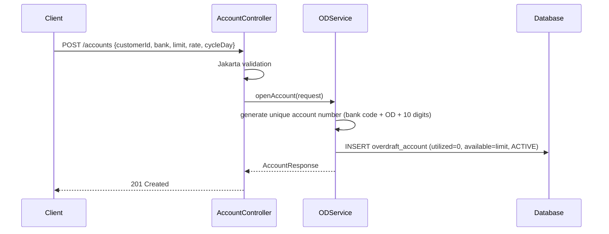
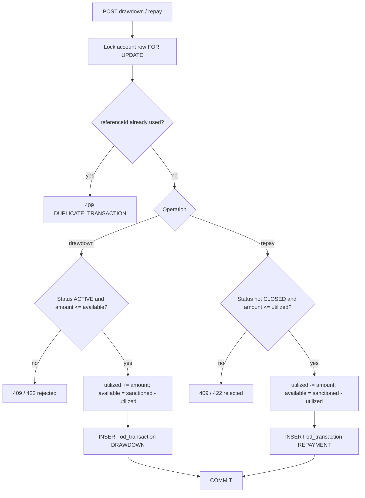
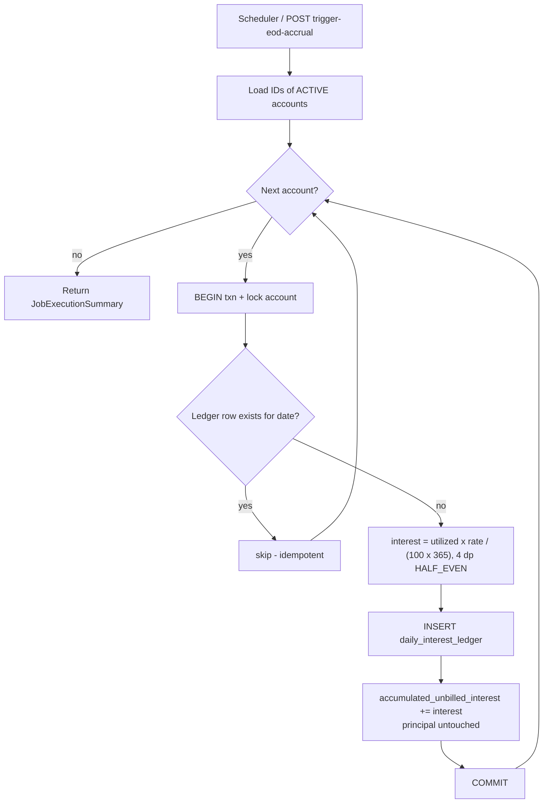
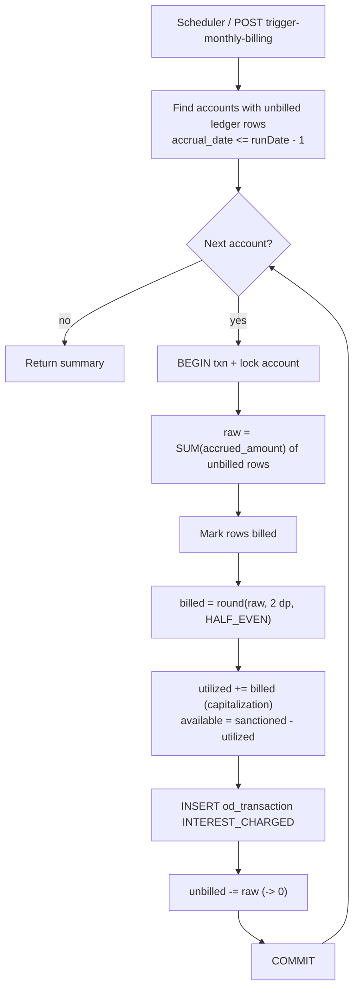

# Enterprise Bank Overdraft (OD) Facility Management System

Production-style Spring Boot 3.2 core-banking module for **overdraft / revolving credit-line** management
(HDFC, AXIS, SBI, ICICI, KOTAK or NBFC rules): account opening, drawdown, flexible repayment, EOD daily interest
accrual, monthly interest billing/capitalization and an OD-vs-Personal-Loan analytics calculator.

- Java 17+ (tested design target: 17 / 21), Spring Boot 3.2.5, Spring Data JPA, Validation, Scheduling
- PostgreSQL (prod) / H2 in PostgreSQL mode (default + tests), Flyway migrations
- `BigDecimal` only: **4 dp internal precision, 2 dp for billing, `RoundingMode.HALF_EVEN`** — no `float`/`double` anywhere in money paths
- springdoc OpenAPI (Swagger UI), Lombok, MapStruct

---

## 1. Architecture Overview

```
src/main/java/com/bank/overdraft/
├── config/       Swagger (OpenApiConfig), Jackson, Scheduling, Clock
├── controller/   REST controllers (OverdraftAccountController, AdminController, AnalyticsController)
├── domain/       JPA entities: OverdraftAccount (aggregate + invariants), Transaction, DailyInterestLedger
├── dto/          Java records with Jakarta Validation
├── enums/        TransactionType, AccountStatus, BankType
├── exception/    GlobalExceptionHandler + domain exceptions (mapped to HTTP codes)
├── mapper/       MapStruct entity -> DTO mappers
├── repository/   Spring Data JPA repositories (pessimistic locks on write paths)
├── scheduler/    @Scheduled EOD accrual + monthly billing jobs
├── service/      Interfaces (ODService, InterestEngine, BillingEngine, InterestCalculationService, ComparisonService)
│   └── impl/     Implementations
└── util/         MoneyUtil (scales + rounding in one place)
```

Layering: `controller -> service (interface) -> repository / domain`. Business invariants live in the
`OverdraftAccount` aggregate (`drawdown`, `repay`, `capitalizeInterest`), so no code path can break
`Available = Sanctioned − Utilized`.

### Key design decisions

| Concern | Decision |
|---|---|
| Concurrency | `SELECT … FOR UPDATE` (pessimistic) on drawdown/repay/accrual/billing + `@Version` optimistic guard |
| Batch isolation | One DB transaction **per account**; a failing account never rolls back the others |
| Idempotency | Ledger has `UNIQUE(account_id, accrual_date)`; billed rows flagged `billed=true`; optional client `referenceId` unique per account |
| Time | Injected `Clock` (zone `Asia/Kolkata`); jobs take an explicit business date so they are testable and replayable |
| Money in API | Rendered as plain decimals (2 dp); accrual amounts exposed at 4 dp |
| Schema | Owned by Flyway; Hibernate runs in `validate` mode |

### 1.1 Account opening



### 1.2 Drawdown & repayment



### 1.3 EOD interest engine (cron `0 59 23 * * *`)



### 1.4 Monthly billing & posting (cron `0 0 1 1 * *`)



---

## 2. Mathematical Analysis of OD Interest

### 2.1 Formula

```
Daily Interest = Utilized Amount × Annual Rate (%) / (100 × 365)
```

Computed as a **single** `BigDecimal` division (`utilized × rate ÷ 36500`) rounded once to 4 dp with `HALF_EVEN`,
so there is exactly one rounding step per day. Only the **closing utilized balance** accrues; unutilized limit costs ₹0.

Billing: `billed = round₂(Σ daily accrued₄)`. The sub-paisa rounding residual (< ₹0.005) is dropped when the
unbilled bucket is reset.

### 2.2 Leap-year handling

| Mode | Property | Denominator |
|---|---|---|
| **Actual/365 Fixed** (default, common Indian bank convention) | `overdraft.interest.leap-year-aware=false` | always 365 |
| Actual/Actual | `overdraft.interest.leap-year-aware=true` | 366 on days of a leap year, else 365 |

Example, ₹3,00,000 @ 12% on 29-Feb-2024: fixed-365 → **98.6301**; leap-aware → **98.3607**.

### 2.3 Day-by-day walk-through (₹15,00,000 limit, 12% p.a., up to ₹3,00,000 used)

| Day | Event | Closing utilized | Unutilized limit | Daily interest (4 dp) | Cumulative |
|---:|---|---:|---:|---:|---:|
| 1 | Draw ₹3,00,000 | 3,00,000 | 12,00,000 | 98.6301 | 98.6301 |
| 2 | – | 3,00,000 | 12,00,000 | 98.6301 | 197.2602 |
| 3 | Repay ₹1,00,000 | 2,00,000 | 13,00,000 | 65.7534 | 263.0136 |
| 4 | – | 2,00,000 | 13,00,000 | 65.7534 | 328.7670 |
| 5 | Re-draw ₹50,000 | 2,50,000 | 12,50,000 | 82.1918 | 410.9588 |
| 6 | – | 2,50,000 | 12,50,000 | 82.1918 | 493.1506 |
| 7 | Repay ₹2,50,000 (full) | 0 | 15,00,000 | 0.0000 | 493.1506 |

Billed at month end (if these were the only accruals): `round₂(493.1506) = ₹493.15`, capitalized into utilized.
The ₹12,00,000+ of idle limit never earns interest. Contrast: interest on the full ₹15,00,000 would be **₹493.1507 per day**.

Day 1–3 of the table is exactly the integration-test scenario (`263.0136` accrued → `₹263.01` billed).

---

## 3. Personal Loan vs Overdraft

| Feature | Personal Loan | Overdraft (this system) |
|---|---|---|
| Disbursal | Lump sum, full amount on day 1 | Draw any amount up to the limit, when needed |
| Payout/repayment structure | Fixed EMIs (principal + interest) | Flexible; interest billed monthly, principal repaid any time |
| Interest basis | Reducing balance on the entire loan amount | Daily, **only on utilized** amount |
| Idle funds | Borrowed and paid for even if unused | Unused limit costs ₹0 |
| Prepayment / foreclosure fee | Typically 2–5% | **Zero** |
| Reusability | One-shot; new loan needed for more money | Revolving: repay and re-draw within limit |
| Interest posting | Embedded in EMI | Accrued daily, capitalized monthly |
| Best for | Known one-time large expense | Variable / uncertain working-capital needs |

### Analytics model (`GET /api/v1/overdraft/analytics/compare`)

- **Personal loan:** principal = `sanctionedLimit`, tenure = `ceil(holdingDays / 30)` months, same nominal rate,
  `EMI = P·r·(1+r)ⁿ / ((1+r)ⁿ − 1)` with `r = rate/1200`, EMI rounded to 2 dp; `interest = EMI·n − P`.
- **Overdraft:** `utilized × rate × holdingDays / 36500` (constant balance, 365 basis).
- **Net savings** = loan interest − overdraft interest (negative ⇒ the loan is cheaper).

---

## 4. Setup Guide

Requirements: JDK 17+ and (optionally) Maven 3.9+. The bundled `./mvnw` uses your system Maven if present,
otherwise downloads Apache Maven 3.9.6 into `.mvn/`.

### 4.1 Run tests

```bash
./mvnw clean test
```

Tests use the `test` profile (H2 in-memory, scheduler disabled).

### 4.2 Run locally with H2 (default, zero setup)

```bash
./mvnw spring-boot:run
```

Swagger UI: <http://localhost:8080/swagger-ui.html> · OpenAPI JSON: <http://localhost:8080/v3/api-docs>

### 4.3 Run with PostgreSQL

```bash
docker compose up -d                       # starts postgres:16 (db overdraft_db, user od_user)
./mvnw spring-boot:run -Dspring-boot.run.profiles=postgres
```

Override via env vars: `DB_HOST`, `DB_PORT`, `DB_NAME`, `DB_USER`, `DB_PASSWORD`.
Flyway applies `V1__init_overdraft_schema.sql` automatically.

### 4.4 Build and run the jar

```bash
./mvnw clean package
java -jar target/overdraft-facility-system-1.0.0.jar                                  # H2
SPRING_PROFILES_ACTIVE=postgres java -jar target/overdraft-facility-system-1.0.0.jar  # PostgreSQL
```

### 4.5 Configuration reference

| Property | Default | Meaning |
|---|---|---|
| `overdraft.timezone` | `Asia/Kolkata` | Zone for business dates and cron triggers |
| `overdraft.scheduler.enabled` | `true` | Turn cron jobs on/off |
| `overdraft.interest.leap-year-aware` | `false` | 365 fixed vs 365/366 day basis |

---

## 5. cURL Examples

```bash
BASE=http://localhost:8080/api/v1/overdraft
```

**1. Open account**
```bash
curl -s -X POST $BASE/accounts -H 'Content-Type: application/json' -d '{
  "customerId": "CUST-1001", "bankName": "HDFC",
  "sanctionedLimit": 1500000.00, "annualInterestRate": 12.00, "billingCycleDay": 1
}'
# -> 201 {"accountNumber":"HDFCOD4821937465", "utilizedAmount":0.00, "availableLimit":1500000.00, ...}
ACC=HDFCOD4821937465   # use the returned number
```

**2. Drawdown**
```bash
curl -s -X POST $BASE/accounts/$ACC/drawdown -H 'Content-Type: application/json' \
  -d '{"amount": 300000.00, "referenceId": "DD-0001", "description": "Working capital"}'
```

**3. Repay (partial or full)**
```bash
curl -s -X POST $BASE/accounts/$ACC/repay -H 'Content-Type: application/json' \
  -d '{"amount": 100000.00, "referenceId": "RP-0001"}'
```

**4. Statement** (`limit` 1–500, default 100, newest first)
```bash
curl -s "$BASE/accounts/$ACC/statement?limit=50"
```

**5. Manual EOD accrual** (`businessDate` optional, defaults to today)
```bash
curl -s -X POST "$BASE/admin/trigger-eod-accrual?businessDate=2026-03-29"
```

**6. Manual monthly billing** (bills accruals up to `businessDate - 1`; `forceAllCycles` defaults to `true` for demos)
```bash
curl -s -X POST "$BASE/admin/trigger-monthly-billing?businessDate=2026-04-01"
curl -s -X POST "$BASE/admin/trigger-monthly-billing?businessDate=2026-04-01&forceAllCycles=false"  # honour billingCycleDay
```

**7. OD vs Personal Loan analysis**
```bash
curl -s "$BASE/analytics/compare?sanctionedLimit=1500000&utilizedAmount=300000&interestRate=12&holdingDays=360"
```

Error format (all endpoints):
```json
{"timestamp":"2026-03-29T10:15:30Z","status":422,"code":"INSUFFICIENT_LIMIT",
 "message":"Drawdown of 1500000.01 exceeds available limit of 1500000.00 on account HDFCOD...",
 "path":"/api/v1/overdraft/accounts/HDFCOD.../drawdown","violations":[]}
```
Codes: `VALIDATION_FAILED`(400), `INVALID_REQUEST`(400), `ACCOUNT_NOT_FOUND`(404), `INVALID_ACCOUNT_STATE`(409),
`DUPLICATE_TRANSACTION`(409), `INSUFFICIENT_LIMIT`(422), `REPAYMENT_EXCEEDS_OUTSTANDING`(422), `INTERNAL_ERROR`(500).

### 5.1 Postman collection

A ready-to-import collection with automated assertions lives in `postman/` (environment included); the step-by-step
scenario and expected values are in [`docs/POSTMAN-TESTING-GUIDE.md`](docs/POSTMAN-TESTING-GUIDE.md).

Structure:

```
Overdraft Facility (collection variables: baseUrl = http://localhost:8080, accountNumber)
├── 1. Accounts
│   ├── Open Account            POST {{baseUrl}}/api/v1/overdraft/accounts          (test script saves accountNumber)
│   ├── Drawdown                POST …/accounts/{{accountNumber}}/drawdown
│   ├── Repay                   POST …/accounts/{{accountNumber}}/repay
│   └── Statement               GET  …/accounts/{{accountNumber}}/statement?limit=50
├── 2. Admin
│   ├── Trigger EOD Accrual     POST …/admin/trigger-eod-accrual?businessDate=2026-03-29
│   └── Trigger Monthly Billing POST …/admin/trigger-monthly-billing?businessDate=2026-04-01
├── 3. Analytics
│   └── Compare OD vs Loan      GET  …/analytics/compare?sanctionedLimit=…&utilizedAmount=…&interestRate=…&holdingDays=…
└── 4. Negative Cases
    ├── Drawdown above limit (422)
    ├── Duplicate referenceId (409)
    └── Invalid payload (400)
```
Open Account test script: `pm.collectionVariables.set("accountNumber", pm.response.json().accountNumber);`

---

## 6. Behavioural Notes & Assumptions

- **Interest accrues on ACTIVE accounts only** (per spec). FROZEN accounts can still repay; CLOSED accounts accept nothing.
- **Capitalization may exceed the limit.** Billed interest is added to `utilized`, so `available` can become negative
  (over-limit). The invariant `available = sanctioned − utilized` is preserved; new drawdowns are blocked until repaid.
- **Repayment cannot exceed `utilized`** (no credit balances). Accrued-but-unbilled interest is not part of the repayable principal until billed.
- **Billing cycle.** The monthly cron (`0 0 1 1 * *`) bills accounts with `billingCycleDay = 1`; a companion job
  (`0 0 1 2-28 * *`) bills accounts whose cycle day equals today's day-of-month. Each run bills all accruals up to the day before.
- **Statement** returns newest entries first, capped by `limit`.
- **Analytics** compares at the *same* nominal rate for a like-for-like structural comparison; real products price differently.

## 7. Production Hardening Checklist

- Protect `/admin/**` (Spring Security, role-based) and add authentication for customer endpoints.
- Run scheduled jobs on one node or add ShedLock; the engines are idempotent so a double run is safe but wasteful.
- Add a holiday calendar if business date ≠ calendar date; add GL posting/event publishing for interest and fee entries.
- Add Micrometer metrics/alerts on `accountsFailed` in `JobExecutionSummary`.
